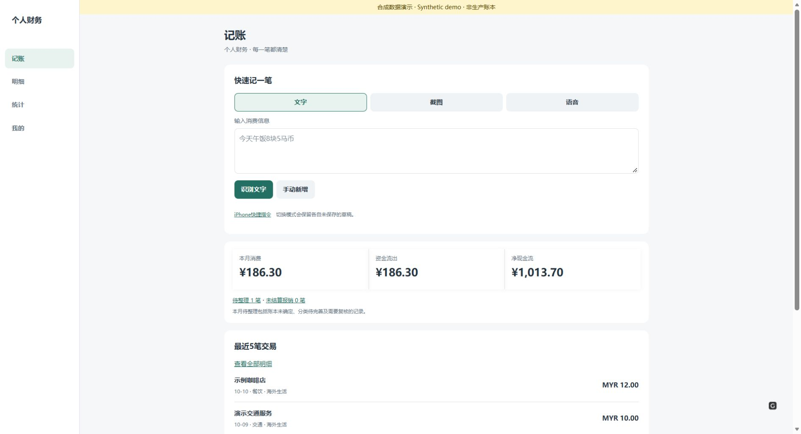
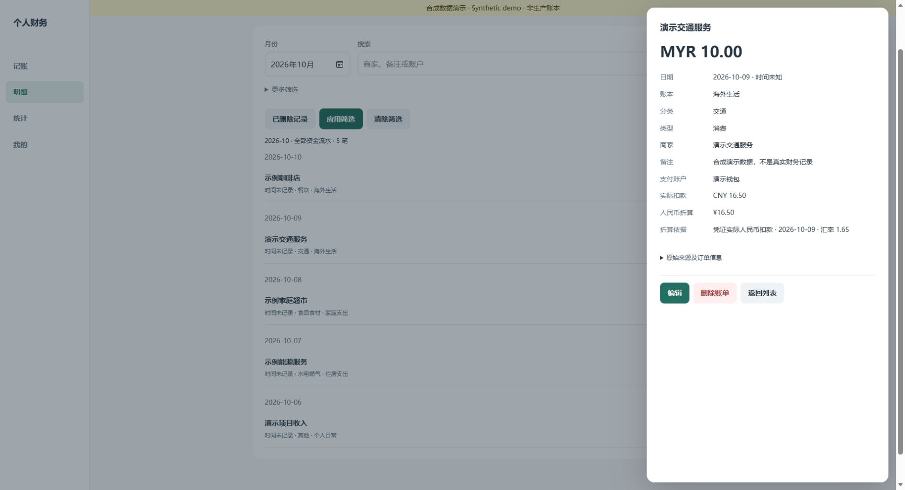

# AI-Assisted Web & Automation Development | AI辅助Web与自动化开发

Lightweight web management apps, admin panels, data dashboards, workflow automation, educational platforms, and WeChat mini programs — all custom scope, subject to review. / 轻量级Web管理应用、后台面板、数据看板、工作流自动化、教育平台与微信小程序——全部定制范围，视评估而定。

---

**Featured case studies / 四个核心项目详细案例：** [Read bilingual case studies / 查看中英文案例详情](CASE-STUDIES.md)

---

## Core Projects | 核心项目

### 1. Personal AI Ledger | 个人AI账本 `PRIVATE`

**English:** Personal finance tracking with intelligent automation. Features Cloudflare Workers + D1 multi-currency expense recording, screenshot-assisted entry for faster data capture. Anonymized screenshots and a bilingual technical case study are now available: [View Personal AI Ledger case / 查看AI记账图文案例](cases/personal-ai-ledger/README.md).

**中文：** 个人财务管理工具，结合智能自动化。采用 Cloudflare Workers + D1 实现多币种费用记录，支持截图辅助录入以提升数据录入效率。现已公开[脱敏的8张产品截图及中英文技术案例](cases/personal-ai-ledger/README.md)，原始源码与个人财务数据继续保密。

- **Stack / 技术栈:** Cloudflare Workers + D1

**Anonymized product screens / 脱敏产品画面**

[Explore all 8 screenshots / 查看全部8张截图](cases/personal-ai-ledger/SCREENSHOTS.md)

---

### 2. Belt & Road Study & Employment Database | 一带一路学习与就业数据库 `PRIVATE`

**English:** Comprehensive database for studying and finding employment along the Belt and Road initiative. Built with Next.js/React/TypeScript/Supabase, includes country-university-major data explorer, tuition fee calculator, CMS for content management, and SEO optimization.

**中文：** 服务"一带一路"倡议的学习与就业综合数据库。基于 Next.js/React/TypeScript/Supabase 构建，涵盖国家-院校-专业数据检索、学费计算工具、内容管理系统（CMS）及搜索引擎优化（SEO）。

- **Stack / 技术栈:** Next.js, React, TypeScript, Supabase

[Case study / 中英文案例详情](cases/belt-road-study/README.md) — includes verification boundaries / 含上线及数据核验边界。

---

### 3. Family Health Management Web Platform | 家庭健康管理Web平台 `PUBLIC CODE`

**Link:** https://github.com/daviddingn-sys/family-companion-platform

**English:** Open-source family health management platform. Supports multiple family roles, blood pressure record tracking with trend charts, medication logging and reminder system, and weekly/monthly rule-based reports. **Not for medical advice.**

**中文：** 开源家庭健康管理平台。支持多家庭成员角色管理，血压记录趋势图表追踪，用药记录与提醒系统，以及基于规则的周报与月报。**不用于医疗建议。**

- **Stack / 技术栈:** Next.js, Supabase, Drizzle

[Family health case study / 家庭健康案例详情](cases/family-health/README.md)

---

### 4. BP Web Monitor | 血压监测Web端 `PRIVATE`

**English:** Blood pressure monitoring web application. Features blood pressure record management, interactive charts, spreadsheet import/export for batch data operations, and photo/OCR integration workflows (subject to configuration).

**中文：** 血压监测Web应用。支持血压记录管理、交互式图表展示、电子表格导入导出以实现批量数据操作，以及照片/OCR识别工作流（视配置而定）。

- **Stack / 技术栈:** Next.js, React, TypeScript, PostgreSQL, Supabase

[Case study / 中英文案例详情](cases/bp-monitor/README.md) — no private medical screenshots / 未公开个人健康截图。

---

## Supporting Projects | 辅助项目

### 5. WeChat BP Mini Program | 微信血压小程序 `PRIVATE`

**English:** Native WeChat mini program for blood pressure record and review workflow. Built with native JavaScript and CloudBase. **Note:** Development stage only; no production deployment claimed.

**中文：** 基于原生微信原生 JavaScript 与 CloudBase 开发的血压记录与审核流程小程序。**注意：** 目前仅为开发阶段，未声称生产环境部署。

- **Stack / 技术栈:** Native WeChat JS, CloudBase

---

### 6. Germany Dual System Website | 德国双元制教育网站 `PRIVATE`

**English:** Informational website covering six vocational education fields under Germany's dual-system model. Built with Next.js to present structured educational content.

**中文：** 介绍德国双元制教育模式下六个职业教育领域的信息网站。基于 Next.js 构建，提供结构化的教育内容展示。

- **Stack / 技术栈:** Next.js

---

### 7. Edu-Finder | 教育搜索工具 `PUBLIC CODE`

**Link:** https://github.com/daviddingn-sys/Edu-Finder

**English:** Minimal educational search tool built with Python Flask, leveraging Google Custom Search API for targeted information retrieval.

**中文：** 基于 Python Flask 的轻量级教育搜索工具，利用 Google 自定义搜索 API 进行定向信息检索。

- **Stack / 技术栈:** Python, Flask, Google Custom Search API

---

### 8. Dual-Education Planning Documents | 双元制教育规划文档

**English:** Planning documents for dual-education initiatives. This is a separate note and not an application or software product.

**中文：** 双元制教育规划文档。此为独立说明，并非应用或软件产品。

---

## Contact / 联系方式

For service inquiries or quote requests, please open a new issue via GitHub Issues: https://github.com/daviddingn-sys/ai-development-portfolio/issues/new

*(GitHub sign-in required. No private-source copying. No false email or unrelated claims.)*

如需服务咨询或报价，请通过 GitHub Issues 提交：https://github.com/daviddingn-sys/ai-development-portfolio/issues/new

（需GitHub登录。不复制私有源码，不含虚假邮箱或不相关声明。）
