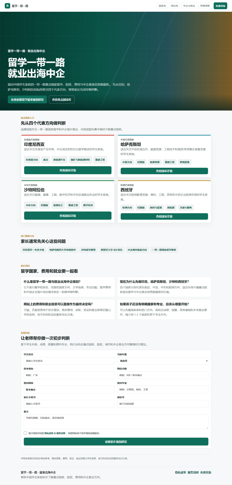
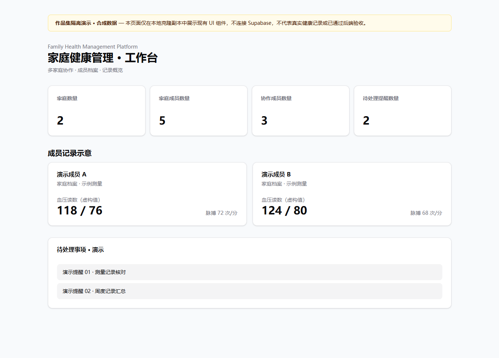
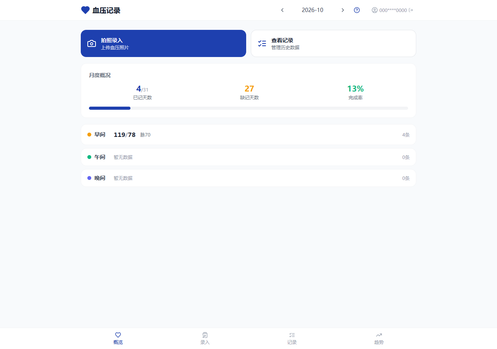

# AI-Assisted Web & Automation Development
### AI辅助定制Web应用与自动化开发

**Turn a workflow into a usable application. / 把业务流程做成真正能使用的软件。**

Lightweight management systems · Data dashboards · Information portals · Import/export workflows · Automation  
轻量级业务管理系统 · 数据看板 · 信息查询平台 · 表格导入导出 · 工作流自动化

**[Discuss a project / 提交开发需求与询价](https://ai-development-portfolio-eight.vercel.app/)** · [View detailed case studies / 查看核心案例详情](CASE-STUDIES.md)

> Anonymous project inquiry requires no GitHub account. Please do not submit passwords, health records or financial account details. / 匿名咨询不需要 GitHub 账号，请勿填写密码、健康记录或财务账号等敏感信息。

---

## What I can build / 可承接的定制方向

| Business need / 业务需求 | Example deliverable / 可交付形式 |
|---|---|
| Organize scattered records / 整理分散记录 | Web management app, searchable database / Web管理后台、信息检索库 |
| Turn spreadsheets into workflows / 将表格业务系统化 | Data entry, import/export, review flows / 数据录入、导入导出、审核流程 |
| See trends and metrics / 查看趋势与指标 | Dashboard, charts, periodic reports / 数据看板、图表及周期报表 |
| Publish structured information / 发布结构化信息 | Education portal, content management / 教育信息门户、内容管理系统 |
| Reduce repetitive work / 减少重复操作 | Workflow integrations and automation / 工作流集成及自动化 |

*Scope, security, integration and acceptance criteria are agreed per project. / 具体功能、安全要求、系统集成与验收标准按项目单独确认。*

## Featured work / 四个重点案例

### 01 · Personal AI Ledger / AI个人记账
**Cloudflare Workers · D1 · Responsive Web**

Multi-currency entry, screenshot-assisted capture, editable review and reporting. / 多币种记录、截图辅助录入、人工核对与统计分析。

[**Explore the illustrated case / 查看8张脱敏截图与完整案例**](cases/personal-ai-ledger/README.md)

### 02 · Belt & Road Study & Employment Database / 一带一路留学就业数据库
**Next.js · TypeScript · Supabase**

Searchable country/university/major information, tuition budget references and content management. / 国家、院校、专业查询，留学费用测算及内容管理。

[**Explore the case and live interface captures / 查看案例及3张真实网页截图**](cases/belt-road-study/README.md)

### 03 · Family Health Management / 家庭健康管理平台
**Next.js · Supabase · Drizzle**

Family roles, records, trend charts and rule-based reports. / 家庭与成员权限、记录管理、趋势图表及规则化报告。

[**Read case / 查看案例**](cases/family-health/README.md) · [Public code / 公开源码](https://github.com/daviddingn-sys/family-companion-platform)

*Isolated UI preview assembled from the project's components with fictional records; no backend verification implied. / 使用原项目组件及虚构数据的隔离界面预览，不代表后台功能已验收。*

### 04 · Blood Pressure Web Monitor / 血压记录Web工具
**Next.js · TypeScript · Supabase/PostgreSQL**

Record entry, monthly summaries, charts and data import/export. / 测量录入、月度概览、趋势图表及数据导入导出。

[**Read case / 查看案例**](cases/bp-monitor/README.md)

*Actual front-end running with synthetic API data, not a clinical product or production database demonstration. / 真实前端使用模拟接口数据，不属于医疗产品或正式数据库演示。*

## Other projects / 其他作品

| Project / 项目 | Focus / 能力方向 | Availability / 代码 |
|---|---|---|
| WeChat BP Mini Program / 微信血压小程序 | Native JS, CloudBase, records workflow / 微信原生开发、云函数、记录流程 | Private / 私有 |
| Germany Dual System Site / 德国双元制教育网站 | Next.js information website / 教育资讯网站 | Private / 私有 |
| [Edu-Finder](https://github.com/daviddingn-sys/Edu-Finder) / 教育搜索工具 | Python Flask, Google Custom Search API | Public code / 公开源码 |

*Dual-education is a planning/documentation repository, not a released application. / Dual-education为规划资料仓库，非独立发布应用。*

## How we work / 合作流程

**1. Describe the goal / 提需求** — Summarize the workflow, target users, key features and existing tools. / 描述业务流程、使用者、核心功能和现有工具。

**2. Confirm scope / 定范围** — Discuss a prototype, architecture, integrations, schedule and acceptance criteria before a quote. / 明确原型、技术路径、集成范围、进度与验收，再确认报价。

**3. Build and review / 开发与验收** — Review milestones using test data before connecting live systems. / 先用测试数据分阶段验收，再考虑接入正式系统。

### [Start a project discussion / 提交需求与询价](https://ai-development-portfolio-eight.vercel.app/)

**Project evidence and privacy / 案例真实性与隐私：** This portfolio displays personal AI-assisted development work and does not imply paid client deliveries, active demos for every project or production-ready regulated systems. Screenshots are either anonymized application captures, public page captures or clearly labeled synthetic UI previews. Private source, financial records, health records and credentials are not published. / 本作品集展示个人AI辅助开发项目，不声称已完成付费客户交付，也不将所有页面包装成可用在线演示。截图区分脱敏真实应用、公开网页和合成数据预览；不公开私人源码、财务记录、健康信息或密钥。
