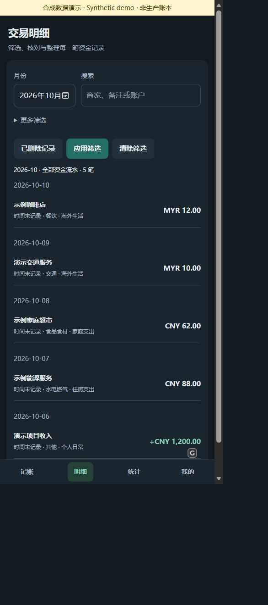

# 脱敏展示截图

2026-10-11使用现有应用前端及Worker在回环地址运行，数据库为全新内存SQLite，仅有10笔合成交易。商家、账户、备注和流水号均虚构；生产数据库、令牌、分类及历史记录未修改。固定1MYR=1.65CNY仅为演示值。通用账本显示名仅修改演示库。

| 文件 | 实际画面 | 验证边界 |
|---|---|---|
| 01-home-desktop.jpg | 文字/截图/语音入口、合成财务摘要 | 实际运行页面 |
| 02-transactions-desktop.jpg | 日期分组、虚构交易 | 实际运行列表 |
| 03-cross-currency-detail.jpg | 原币MYR10.00，实际扣款和统计CNY16.50 | 真实Worker保存至演示SQLite |
| 04-statistics-desktop.jpg | 合成月度金额与账本占比 | 合计186.30=88+62+36.30 |
| 05-home-narrow.jpg | 底部导航、窄屏记账 | Edge响应式，不是Safari实机 |
| 06-image-entry-narrow.jpg | 截图选择/拍摄入口互斥文字模式 | 没有实测iPhone相机权限 |
| 07-transactions-narrow-dark.jpg | 深色窄屏明细 | 实际主题切换 |
| 08-cross-currency-review-dark.jpg | 系统OCR文字分享入口形成核对表 | 使用合成文字，不是本轮图像OCR准确率测试 |

窄屏首页申请390×844，但Edge实际DOM为488×1055；第8张核对表补拍截取页面内容区域以展示两组金额，排除浏览器插件外围面板。部分截图画布包含后端截取留白。不得标注为iPhone390px实机截图。浏览器插件小图标不是项目功能。

本月5笔：收入1200，个人消费/流出186.30，净现金流1013.70；MYR12×演示率1.65=19.80，加跨币种扣款16.50、家庭62、住房88。还有1笔演示待整理提醒，不隐去不完整分类状态。

